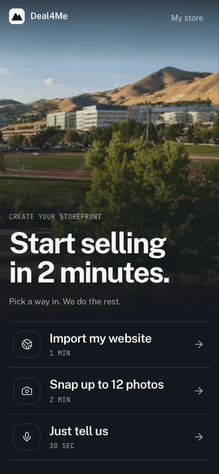
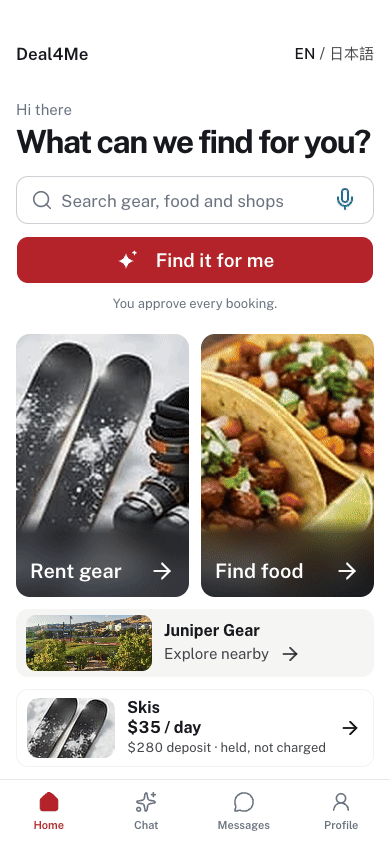
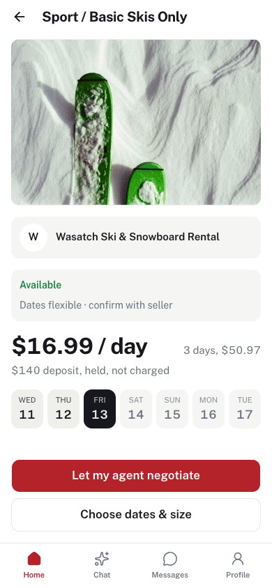
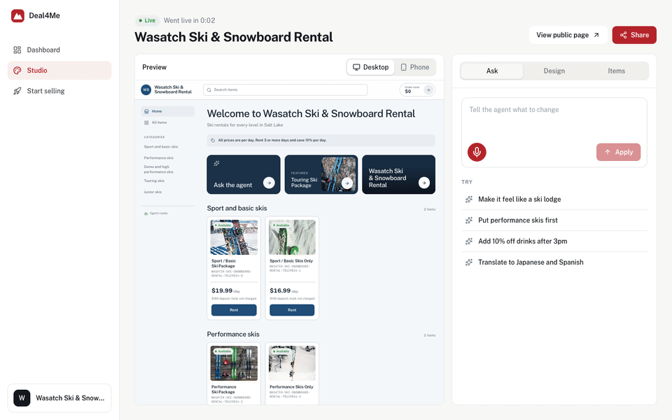
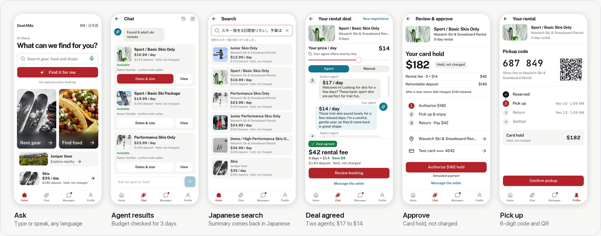
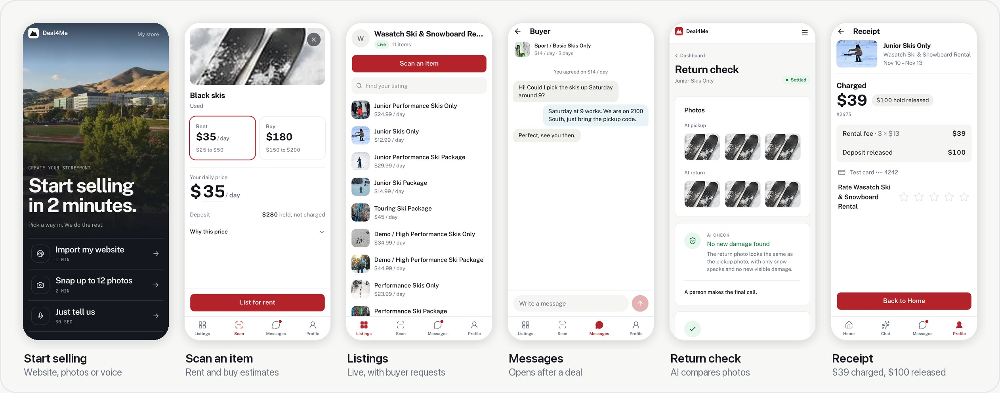
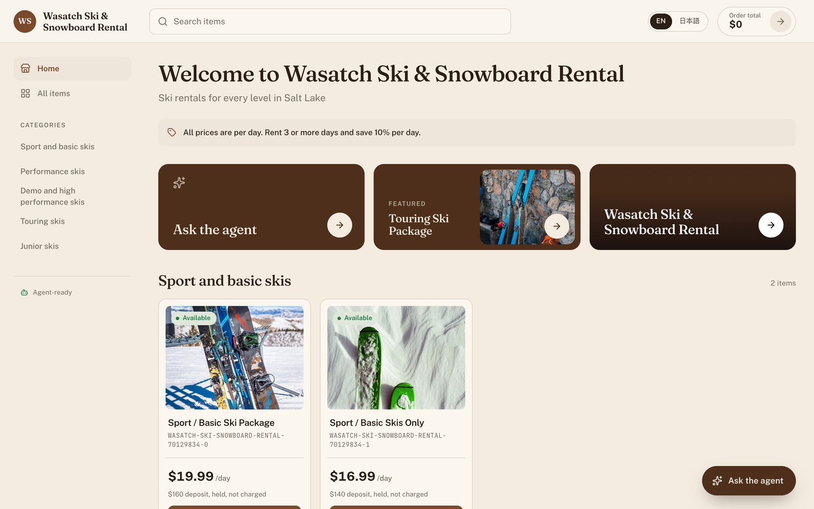
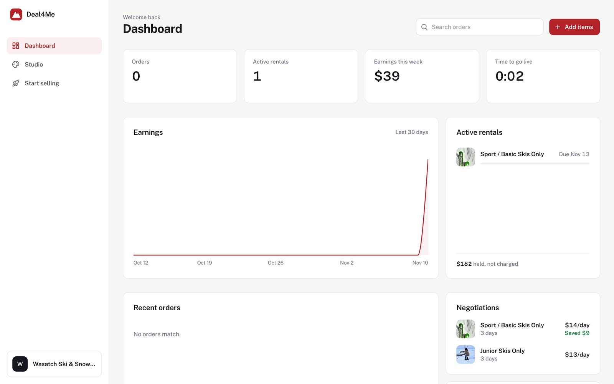
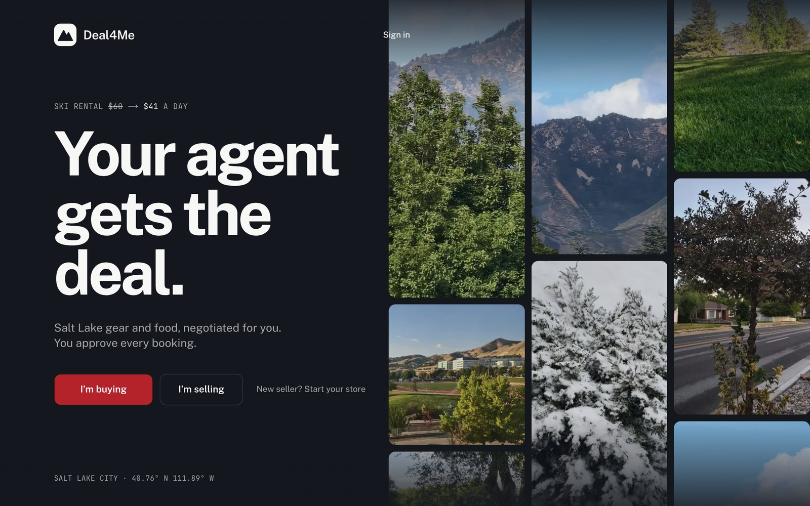

<p align="center">
  
</p>

<p align="center">
  
  
  
  
</p>

<p align="center">
  <b>🏆 Winner, Best Use of AI · Crimson Hack 2026</b><br>
  A local marketplace for Salt Lake City, built on the Claude Agent SDK<br><br>
  <a href="#-see-it-run">See it run</a> ·
  <a href="#-the-loop">The loop</a> ·
  <a href="#-two-agents-one-deal">Two agents, one deal</a> ·
  <a href="#-ask-in-any-language">Search</a> ·
  <a href="#-system-design">System design</a> ·
  <a href="#-rentals-and-money">Rentals</a> ·
  <a href="#-results">Results</a> ·
  <a href="#-run-it">Run it</a> ·
  <a href="#-team">Team</a>
</p>

---

The ski shop by campus has great gear and no website. The taco truck has a menu on a chalkboard. Getting either one online means photos, prices, copy and a storefront, which takes a weekend nobody has. On the other side, a visitor who wants skis for three days under $150 opens six tabs, does the math by hand and either haggles by DM or overpays.

**Deal4Me puts an AI agent on both sides of a local deal.** A shop owner says one sentence, snaps up to 12 photos or pastes their website, and Claude builds a priced storefront that goes live in seconds, illustrated with the owner's photos, photos from their site or bundled stock images. A buyer asks in plain language, typed or spoken and in any language, and gets listings whose prices code has already checked against their budget and dates. Then two private Claude Haiku agents haggle: one holds the owner's secret floor, the other holds the buyer's price, and `rules.ts` decides every legal move. **The model writes the words and picks each move; code sets the legal range and clamps every price.** Nothing is charged until a person approves, and the deposit is *held, not charged*.

> **The demo moment.** The owner types *"I run Juniper Gear, a ski rental shop near campus. Skis rent for thirty five dollars a day, and ski and boot sets rent for forty five dollars a day."* and taps **Build my storefront**: two priced listings with photos, then **Go live**, and the screen reads *Live in 0:09*. On the buyer's phone, *"Adult skis for 3 days under $150"* comes back as *"Found 6 adult ski rentals."*, each one checked at 3 × its daily fee. The buyer opens another shop's listing, *Sport / Basic Skis Only* from Wasatch Ski & Snowboard Rental (imported from its website, $16.99/day), sets **Your price** to $14 and taps **Start negotiating**. That shop's agent opens at $17 and concedes to $16 and then $15, the buyer's agent gives a new reason each turn, and the shop's agent accepts $14 after 27 seconds: **Deal agreed · $42 rental fee · Save $9**. Run it again at $9 and the shop's agent comes down to $11, its private floor, and goes no lower: *No deal at this price*. No deal can ever land below the floor.

## 🎬 See it run

<table>
  <tr>
    <td width="33%" valign="top"></td>
    <td width="33%" valign="top"></td>
    <td width="33%" valign="top"></td>
  </tr>
  <tr>
    <td valign="top"><sub><b>Seller: one sentence to a live store.</b> The demo script's extraction is replayed from the cache a live Claude Sonnet run created during rehearsal, so it lands instantly; any new description is extracted live.</sub></td>
    <td valign="top"><sub><b>Buyer: ask once.</b> Claude Haiku turns the sentence into a filter and picks the adult listings by meaning; code checks every price for 3 days against $150. Recorded live.</sub></td>
    <td valign="top"><sub><b>Two agents haggle, a person approves.</b> Live Haiku run, $17 → $16 → $15 → deal at $14. Waiting time between rounds is shown at 2× speed.</sub></td>
  </tr>
</table>

<p align="center">
  
</p>

<p align="center"><sub><b>Edit the store by asking.</b> The studio sends the instruction and the current design to Claude Sonnet, which may only fill a strict schema (theme preset, five colours, font, corners, copy, section order, promo, languages). Applied in 3.8 s, recorded live; <b>Undo</b> restores the previous design. Agent thinking time is shown at 3× speed.</sub></p>

<p align="center">
  
</p>
<p align="center">
  
</p>

<p align="center"><sub>Every screen above was captured headless from this repository, running on a new workspace with an empty catalog (the AI cache from rehearsals carried over). The workspace was then filled through the real flows: two descriptions and one website import (replayed from that cache), live searches in English and Japanese, three live negotiations, two holds, one live Claude damage check and one settlement.</sub></p>

## 🔁 The loop

<p align="center">
  
</p>

Claude does the reading, writing and judging. Code does the arithmetic, the limits and the bookkeeping. Every call runs as an isolated, headless Claude Code session through the [Claude Agent SDK](https://www.npmjs.com/package/@anthropic-ai/claude-agent-sdk), returns JSON that matches a schema, and is checked again with zod before anything is saved:

| Step | Model · effort · timeout | Sees | Returns | Then code… |
|---|---|---|---|---|
| **Describe** a shop (voice or text) | Sonnet · low · 25 s | the transcript, as untrusted text in any language | shop name, tagline, up to 12 items with kind and price | fills missing prices via `suggest-price`, sets deposits and a private minimum, groups sections |
| **Photograph** items (up to 12) | Sonnet · medium · 30 s (vision), then Haiku · low · 20 s | the photo, plus an optional hint (≤300 chars, untrusted) | identity, condition, value; rent and sale estimates with ranges | enforces the rent floor (≥10% of value per day, rounded up), clamps by gear class, computes the deposit |
| **Import** a website | Sonnet · medium · 60 s, only when the page has no schema.org Product or MenuItem records | title, headings, ≤18,000 chars of text, ≤40 image URLs | theme, font, sections, up to 12 items | blocks private addresses, keeps only photos from the page, swaps text to near-black or white when it is under 4.5:1 contrast |
| **Edit** the storefront | Sonnet · low · 25 s | the instruction plus the current design | only the fields that were asked for | applies non-null fields, ignores unknown sections, offers **Undo** |
| **Search** | Haiku · low · 30 s | the query, plus the catalog's names, descriptions, categories and tags (no prices) | a filter: kind, keywords, days, budget, budget period, dates, size, matching ids, language | checks daily fee × days against the budget, enforces max days, ranks items free for the dates and size first, returns the top 6, strips the owner's floor and price suggestion |
| **Negotiate** | Haiku × 2 · low · 20 s per call (a rejected reply is retried once) | the owner: its private floor; the buyer: its client's fixed price, which it offers openly every turn; both: the public item card and the last 12 chat lines | action, price, price-free message | clamps the price to the legal range, rejects disallowed moves and any line that contains a number |
| **Damage check** | Sonnet · low · 30 s | 1–3 pickup photos and 1–3 return photos | `clear` or `review`, each with a one-sentence note | shows it to the owner. A person settles |
| **Speech** | Whisper large-v3-turbo on [mlx-audio](https://github.com/Blaizzy/mlx-audio), local, no Claude | the recording (live previews every 1.5 s as 16 kHz mono) | text and detected language | puts the text in the box to review. It never submits |

Each backend session starts clean: no settings, MCP servers, skills, `CLAUDE.md` or memory, no tools (comps alone may use WebSearch), and an empty temporary working directory. After each successful call, a spare session with the same system prompt, model, effort and schema starts in the background (up to 4 are kept), so the next call of that kind skips startup. The first call of each kind starts cold. On the JSON routes, a missing login returns **503** with *"AI is not connected…"*, and any other AI failure returns **502** with a short, safe message. The two streaming routes, website import and agent-vs-agent negotiation, send that message as an `error` line instead. **No route substitutes demo data for a failed call.** The one fallback: if the photo flow's Haiku pricing step fails, code prices the item from Sonnet's own value estimate.

## 🤝 Two agents, one deal

<p align="center">
  
</p>

**The owner knows one secret, the buyer argues for one fixed price, and code screens every line for numbers.**

| | Owner agent | Buyer agent |
|---|---|---|
| Knows privately | the item's **private minimum** (the floor). The seller sets it for a rental, and only seller screens load it. For a sale item it is derived from the price (70–90%). No buyer screen shows it | **its client's price**, which it offers every turn and cannot change. The owner sees the number but not that it is final |
| Sees | the public item card, the last 12 chat lines and the buyer's current offer | the public item card, the last 12 chat lines and the owner's current ask, never the floor |
| Can do | `accept` · `counter` · `hold` · `walk`, but only the moves `rules.ts` allows that turn | `offer` exactly its price, or `accept` once the ask has come down to it |
| Says | told to use ≤16 words (code caps a line at 120 characters), stay warm and playful and move toward the buyer in shrinking steps, because *"a deal beats no deal"* | told to use ≤16 words (same 120-character cap) and give a **new** reason each turn |
| Model | Claude Haiku, effort low, a fresh session every turn | Claude Haiku, effort low, a fresh session every turn |

**Code holds the line** ([`src/server/deals/rules.ts`](src/server/deals/rules.ts)). Every owner turn, code works out the legal moves before the model is asked:

- If the offer is at or above the ask, the only move is to accept at the ask.
- On the final turn, accept if the offer is at or above the floor, otherwise walk.
- Otherwise a counter must sit between `max(floor, offer + $1, ask − 60% of the gap)` and `ask − $1`. Each counter therefore concedes at least $1 and at most 60% of the gap, never goes below the floor, and the ask never rises.
- Any price the model returns is snapped into that range, and a move that isn't allowed is refused and retried once with the reason.

**Prices travel only as structured fields.** `cleanLine` rejects any message with a digit or a currency symbol. It also rejects a list of currency words and common spelled-out numbers in English, Japanese, Spanish, French, German, Korean and Chinese. The list is not exhaustive: a few forms, such as German compound numbers, still pass. It rejects *floor/minimum/最低/下限* from the owner and *max/maximum/上限/最大* from the buyer, so neither agent can name its limit with those words; only the prompt forbids subtler hints. The client sends only the buyer's own price. List price and floor are read from the saved catalog, and the hold and item requests use the agreed price stored with the deal.

**What the tests prove** ([`rules.test.mjs`](src/server/deals/rules.test.mjs)). 26,730 adversarial negotiations play random legal moves with hostile prices (`NaN`, `±Infinity`, `1e12`, negatives) across 11 list prices, 9 floors, 9 buyer prices and 5 round limits. In every run the buyer never offers above its price, the owner never goes below its floor, the ask never rises and the negotiation always ends. **A deal happens if and only if the buyer's price is at or above the floor, and it lands at exactly `min(buyer price, list)`.**

<details>
<summary><b>A real transcript</b>, verbatim from <code>.data/negotiations.json</code> (the run animated above)</summary>

*Black skis*, a 3-day rental listed at $35/day. The owner's private floor is $22/day and the buyer's price is $30/day. Recorded 7 Nov 2026, about 38 s from the owner's opening line to the deal.

| Round | Who | Price | Legal range from `rules.ts` | Message |
|---|---|---|---|---|
| 1 | owner | $35 | opening | Hi there! Those black skis are in good shape. Tell me about your ski plans? |
| 1 | buyer | $30 | offer exactly $30 | Just a short trip on groomed runs, and I'll return the skis clean and dry. |
| 2 | owner | $33 | counter $32–$34 | Sounds like a sweet little outing! Stretch a bit higher and they're yours. |
| 2 | buyer | $30 | offer | I'll pay the full amount upfront, so there's no hassle for you at all. |
| 3 | owner | $32 | counter $32 only | Paying upfront is a lovely perk, and these skis are worth a touch more. |
| 3 | buyer | $30 | offer | Honestly, a short groomed-run trip is all I need, so these would be treated gently. |
| 4 | owner | $31 | counter $31 only | Let's nudge it a little, and these black skis are yours to ride. |
| 4 | buyer | $30 | offer | I'll be back on time with the skis, so your shop looks great. Shall we shake on it? |
| 5 | owner | **$30** | accept or hold (a counter is impossible: min $31 > max $30) | Groomed runs and a clean return, you've got a deal. Enjoy the slopes! |

**Deal at $30/day:** $90 for 3 days, $15 saved, $280 deposit held, so the card hold is $370.
</details>

The negotiate screen streams the rounds as NDJSON from `POST /api/deals/negotiations/auto`. Each bubble types itself out, older rounds fold under *Earlier rounds*, and leaving the screen aborts the stream so no further Haiku calls are made. **Manual** mode lets the buyer haggle directly. The owner agent then runs in a stricter mode with no early walk, because a forced walk would reveal the floor, and a lower offer than before counts as chat.

## 🔎 Ask in any language

<p align="center">
  
</p>

**Haiku reads the request and picks the items that match it. Code decides what fits the budget and the trip.** [`src/server/ai/search.ts`](src/server/ai/search.ts) sends Haiku the query and the catalog's ids, kinds, names, descriptions, categories and tags. It never sends prices, floors or availability. Haiku returns a filter:

- the **kind** (rental, food, sale)
- a **category**, which must be one the catalog actually has
- English **keywords**, even for a Japanese query
- **rentalDays** and the **budget**, with whether it is daily or for the whole trip (*"skis for 3 days under $90"* means $90 total). Yen is converted at ¥150 per dollar
- **dates** in America/Denver and a **size**
- the **matching item ids**, chosen by meaning, so *"adult skis"* drops the junior packages
- a one-line **summary template** in the query's own language

**Code then runs that filter on live data.** It keeps only published shops. A total budget is checked against `days × daily fee`, so *3 days under $150* means *≤ $50/day*. The item's max days must cover the trip. Items available for the requested dates and size sort first. It returns at most 6, and strips each item's private minimum and price suggestion before the response leaves the server. Only the parsed filter is cached, keyed by the normalized query, language, today's date and the catalog's content, so **prices are checked fresh on every search**.

The buyer app ships in English and 日本語. Queries, search summaries and the agents' negotiation lines work in English, Japanese, Spanish, French, German, Korean and Chinese. Storefronts can add languages from the studio.

## 🏗 System design

<p align="center">
  
</p>

**One Next.js 16 app, three API families, JSON on disk.** 36 Deal4Me pages (plus 12 in the separate `/rapport` prototype), 25 route handlers and about 110 components, all TypeScript.

| Layer | What lives there |
|---|---|
| **Buyer phone** `/visit/*` | Home · Chat (the agent) · Messages · Profile, plus search, item, negotiate, checkout, rentals, receipt, food order and bookings. Rendered in a 390 × 844 `PhoneFrame` on desktop |
| **Seller phone** `/seller/*` | Listings (with buyer requests) · Scan · Messages · Profile, plus *Change my store* by voice, text or photo |
| **Seller desktop** `/sell/*` | Onboarding (`start`, `describe`, `photos`, `import`), the storefront studio, the dashboard and the owner's return check |
| **Public storefront** `/s/[slug]` | Themed, multilingual shop page, with a cart for food and Rent / Buy for gear |
| **`/api/ai/*`** (9) | `describe`, `appraise`, `appraise/comps`, `suggest-price`, `restyle` (NDJSON stream), `storefront-instruction`, `search`, `damage-check`, `transcribe` |
| **`/api/deals/*`** (3) | `negotiations` (list, start manual), `negotiations/auto` (two agents, NDJSON stream), `negotiations/[id]/messages` (manual turns) |
| **`/api/data/*`** (13) | `state`, `shops`, `shops/[id]/publish`, `items`, `orders`, `orders/[id]/status`, `requests`, `messages`, `chats`, `rentals/hold`, `rentals/[id]/pickup`, `…/return`, `…/settle` |
| **Server** `src/server/*` | `ai/` (`askClaude`, pricing, search, restyle, website fetch, cache), `deals/` (agents, `rules.ts`, catalog, store), `data/` (catalog store, zod schema, conversations, rental ledger), `availability.ts` |

**Persistence is deliberately boring.** Everything is stored as JSON in `.data/`, which is ignored by git; point `RIDGE_DATA_DIR` at another directory to use a different workspace:

| File | Holds |
|---|---|
| `catalog.json` | shops, items, food orders, rentals, item requests (a missing file is an empty workspace) |
| `conversations.json` | buyer–seller threads, keyed by negotiation id, and saved agent chats |
| `negotiations.json` | every negotiation, with its private state (the floor) kept server-side |
| `ai-cache/<namespace>/<sha256>.json` | saved AI results: `descriptions-v1`, `websites`, `photo-appraisals`, `search-filters-v2` |

Each write reads, changes, re-validates the whole state with zod, writes a temp file (mode `0600`) and renames it over the old one, so a crash never leaves half a file. The client hydrates from `GET /api/data/state` and refreshes on focus, on reconnect and every 15 s. Buyer screens get the public catalog, without any rental's private minimum or the price suggestions that sale floors come from. Seller screens (`/sell`, `/seller`) ask for `?view=seller`, the only response that includes them, and switch views when you move between the two. Messages poll every 3 s. Shop edits and order status changes go through per-record queues, and a failure shows a toast with **Retry**. Browser storage holds per-device state: the visitor profile, timers, carts, the selected store, saved chats and a copy of messages. Catalog records and transactions always come from the server. **No mock records are seeded**: a new workspace starts empty, and an AI or data failure shows its error. Sample photos replay captured appraisals, labelled as such. `src/lib/mock-api.ts` and most of `src/lib/mock-data.ts` are unused leftovers from the prototype.

## 💳 Rentals and money

<p align="center">
  
</p>

| State | Reached by | What happens |
|---|---|---|
| `reserved` | **Authorize $X hold** → `POST /api/data/rentals/hold` | Hold = days × daily price + deposit, computed on the server: the agreed price and days come from the **stored deal**, or the item's list price when no negotiation is sent. The client never sets the price. One hold per negotiation. 6-digit pickup code + QR |
| `picked_up` | **Confirm pickup** → `POST /rentals/[id]/pickup` | 3 pickup photos saved |
| `returned` | **Start return** → `POST /rentals/[id]/return` | 3 return photos + **Claude damage check**: *clear* or *review*, each with a one-sentence note. Lighting, angle and background don't count, and the prompt says *"Do not accuse anyone."* |
| `settled` | Owner: **Settle** or **Report damage** → `POST /rentals/[id]/settle` | Captured = `min(hold, fee + damage)`, released = the rest. A damage charge must be > $0 and ≤ the deposit, and needs a note |

Every transition returns **409** if it is out of order. Payments run on a **simulated ledger**: the rental record itself is the ledger (`holdCents`, `capturedCents`, `releasedCents`), the `PaymentProvider` interface (`authorize`, `capture`) is a no-op, and every successful hold and settle response carries `x-payment-mode: simulated`. No card is touched and no money moves. Food orders follow `placed → accepted → ready → picked_up` one step at a time, each with a 6-digit pickup code, and the total is computed from stored prices.

## 🛡 Guardrails

These are code and tests, not prompts:

- **The floor stays out of buyer screens, search, the agents' lines and the negotiation list.** `GET /api/data/state` and search strip each rental's `minDailyFeeCents` and each item's price suggestion, whose low end sets a sale item's floor. Only seller screens ask for `?view=seller`, which includes both, and a seller save that leaves them out keeps the stored ones (the minimum capped at a lower new daily fee). The negotiation list blanks private fields, the owner agent's lines can't contain numbers or limit words, and in manual mode the owner never walks early, because a forced walk would reveal the floor. There are no accounts yet, so any client can still ask for the seller view (see [Limits](#-limits)).
- **The model never picks a number outside the rules.** Prices are integers in a structured field and are clamped to the legal range. A disallowed action is refused. The buyer agent can only offer its exact price.
- **Every price comes from saved data.** Negotiation, hold, request and food order routes read list price, floor and agreed price from the catalog or the stored deal, and zod drops anything else the client sends.
- **Untrusted text stays data.** Transcripts, hints, website text, item cards and chat history go inside delimited blocks marked untrusted, never into system prompts. Model output can only point at items and photos that already exist: search keeps catalog ids only, and an imported item keeps a photo only if it came from that page.
- **Website import blocks private addresses.** `http(s)` only, no credentials, ports 80/443 only, no `localhost`/`.local`/`.internal`. DNS is resolved and checked against private, loopback and reserved ranges (including IPv4-mapped IPv6) before every hop. The fetch resolves the name again, so DNS rebinding is not ruled out. At most 5 redirects, 12 s and 2 MB, and 14 hostile URLs in the tests.
- **Sample results can't be spoofed.** Sample photos match on the SHA-256 of their bytes plus the kind, so renaming a file can't select them. Their responses say `basis: "demo"` and `demoSource: "captured_ai"`, and the UI labels them as prepared.
- **People decide.** Voice fills a text box and never submits. The buyer approves every booking. A damage check only flags a return for review, and *a person makes the final call*.
- **Uploads are bounded.** Photos sent to Claude must be JPEG, PNG, WebP or GIF and ≤5 MB (appraisal answers SVG with **415**), and one photo import takes at most 12. Audio is ≤25 MB, and a recording stops at 90 s.

## 📊 Results

**Measured on 10 Nov 2026** on a new workspace with an empty catalog (its AI cache carried over from rehearsals), using live Claude calls unless marked *cached*:

| What | Result |
|---|---|
| Juniper Gear, from the demo description to a live store | *Live in 0:09*, 2 rentals at $35 and $45/day with photos, deposits $280 and $360 (cached extraction) |
| Wasatch Ski & Snowboard Rental, from its website | 11 rental packages with the site's prices, shown with bundled stock photos (cached website snapshot) |
| *"Adult skis for 3 days under $150"* | *"Found 6 adult ski rentals."* 9 matched and the list is capped at 6. Junior packages were dropped by meaning, and the cheapest available came first |
| *スキー板を3日間借りたい。予算は150ドル* | *"6件のスキー板が見つかりました。"* (the summary in Japanese) |
| Negotiation at $14 on skis listed at $16.99 (owner floor $11) | Owner $17 → $16 → $15 → **accept $14** in 27 s, 7 messages. $42 for 3 days, save $9 |
| Negotiation at $9, below the $11 floor | Owner concedes to $11 and stops: *No deal at this price*. The floor held |
| Studio: *"Make it feel like a cozy ski lodge and translate it to Japanese"* | *Theme → Ski lodge · Languages → Add Japanese* in 3.8 s (Sonnet) |
| Damage check, pickup vs return photos | `clear` in 2.2 s for $0.0075: *"…only snow specks and no new visible damage."* |
| Settlement, $139 hold (3 × $13 + $100) | $39 captured, $100 released, receipt issued |
| Sample photo appraisals (captured from live Claude, 6 Nov 2026) | Skis $35/day (deposit $280) or $180 to buy · ski and boot set $45/day ($360) or $220 to buy · taco plate $12 |

**Tests**, all green:

| Suite | Tests | What it pins down |
|---|---|---|
| [`src/server/deals/rules.test.mjs`](src/server/deals/rules.test.mjs) | 15 | the deal invariant across 26,730 fuzzed runs, edge cases (free floor, floor above list, $1 ask), clamping and snapping, the manual-mode floor, and `cleanLine` in 7 languages |
| [`src/server/ai/rent-floor.test.mjs`](src/server/ai/rent-floor.test.mjs) | 11 | rent ≥ 10% of value per day, rounded up with no float drift ($7, $14, $29, $70…), a $1 minimum, ranges kept ordered, input never mutated |
| [`src/server/ai/website-source.test.mjs`](src/server/ai/website-source.test.mjs) | 6 | JSON-LD and microdata menus, entity decoding, non-USD prices dropped, 14 SSRF URLs rejected, tracking params stripped |
| TypeScript | — | `npx tsc --noEmit --incremental false` passes |

## 🖥 The interface

<p align="center">
  
</p>
<p align="center"><sub><b>The public storefront</b> <code>/s/[slug]</code> after the studio edit above, with a floating <b>Ask the agent</b> button and the EN / 日本語 switch the edit added.</sub></p>

<table>
  <tr>
    <td width="50%" valign="top"></td>
    <td width="50%" valign="top"></td>
  </tr>
  <tr>
    <td valign="top"><sub><b>Seller dashboard.</b> KPIs, 30-day earnings (picked-up orders, plus rentals once they come back; open holds don't count), active rentals with time used, recent orders with Accept → Mark ready → Picked up, and the latest deals.</sub></td>
    <td valign="top"><sub><b>Landing.</b> <i>Your agent gets the deal.</i> Three photo columns drift over 130–170 s, and reduced motion turns them off.</sub></td>
  </tr>
</table>

The design contract lives in [DESIGN.md](DESIGN.md): **one message per screen, one primary action per view.** Crimson (`#b4232a`) marks only the single main action, the active tab and the key chart line. Glacier blue (`#0e7490`) is always the buyer's own agent. Ink panels carry the drama. Type is Public Sans, with JetBrains Mono for IDs, SKUs and pickup codes. Money shows in dollars (with cents only when a price has them) and tabular figures, and a deposit always reads *held, not charged*. Phone screens are designed for 390 × 844 and the desktop for 1710 × 1107. Storefronts have 4 presets (Ski Lodge, Food Truck, Alpine Minimal, Night Market), 6 accents, 3 fonts and 3 corner styles, and sign-in has 3 themes (Park & Pine, Sky & City, Golden Local).

## 🚀 Run it

**Requirements:** Node 22.18+ and a Claude login. Voice input also needs [`uv`](https://docs.astral.sh/uv/) on Apple Silicon, for the local speech server.

```bash
npm install
npm run dev                        # open the URL Next.js prints (http://localhost:3000 by default)
```

AI calls run through the Claude Agent SDK. Either put `ANTHROPIC_API_KEY=…` in `.env.local`, or sign in once with the Claude CLI, then restart the dev server:

```bash
claude auth login
```

For voice, run the local Whisper server (mlx-audio 0.6.4, `whisper-large-v3-turbo`) in a second terminal. Typed input works without it:

```bash
npm run stt                        # http://127.0.0.1:8765 (the app reads STT_URL / STT_MODEL)
```

Warm and verify the demo caches (two sample websites, two voice scripts, three sample photos) before presenting. This fails loudly if anything isn't served from cache:

```bash
npm run demo:prepare -- http://localhost:3000
```

Start a clean, separate workspace without touching `.data/`:

```bash
RIDGE_DATA_DIR=/tmp/deal4me-workspace npm run dev
```

Check the claims yourself:

```bash
node --test src/server/deals/rules.test.mjs src/server/ai/rent-floor.test.mjs src/server/ai/website-source.test.mjs
```

```bash
npx tsc --noEmit --incremental false
```

| Open | To |
|---|---|
| `/` | the landing page: **I'm buying** / **I'm selling** |
| `/sell/start` | create a store from your website, photos or voice |
| `/visit` | the buyer phone |
| `/seller` | the seller phone |
| `/sell/dashboard`, `/sell/studio/<shopId>` | the seller desktop |
| `/s/<slug>` | a public storefront |
| `/dev` | an index of the main screens and every saved store (storefront and studio); `/dev/voice` tests speech + search |

**Try these** after publishing a ski shop and a taco shop: *Find all-mountain skis under $50 per day* · *I need skis for 3 days under $150* · *スキー板を3日間借りたい。予算は150ドル* · *Find fish tacos under $6*.

<details>
<summary><b>Repository map</b></summary>

```
src/
├─ app/
│  ├─ api/ai/*            9 AI routes (describe, appraise, comps, suggest-price, restyle, storefront-instruction, search, damage-check, transcribe)
│  ├─ api/deals/*         negotiations: start, two-agent auto stream, manual turns
│  ├─ api/data/*          shops, items, orders, requests, rentals, messages, chats, state
│  ├─ visit/*             buyer phone          seller/*   seller phone
│  ├─ sell/*              onboarding, studio, dashboard, return check
│  └─ s/[slug]            public storefront    dev/*      route index and test pages
├─ server/
│  ├─ ai/                 claude.ts (askClaude), pricing, rent-floor, search, restyle, website-source, cache
│  ├─ deals/              agents.ts, rules.ts (+ tests), catalog, store, parse-offer
│  └─ data/               store.ts, schema.ts (zod), private-terms (public projection), conversations, rentals (simulated ledger)
├─ components/            onboarding, storefront, visitor, deals, seller, dashboard, messages, shared, ui (shadcn on Base UI)
└─ lib/                   Zustand store, sync queues, real API client, voice input, brand
scripts/                  prepare-onboarding-demo.mjs, backfill-gear-photos.mjs
public/                   demo photos, ski listing photos (credits in public/listings/SOURCES.md), audio worklet
```

`src/rapport` and `src/app/rapport` hold a separate, fully seeded phone prototype that no Deal4Me screen links to.
</details>

**Built with** Next.js 16 (App Router, Turbopack), React 19, Tailwind CSS 4, shadcn/ui on Base UI, Zustand 5, zod 4, Recharts 3, `qrcode.react`, the [Claude Agent SDK](https://www.npmjs.com/package/@anthropic-ai/claude-agent-sdk) (Claude Sonnet and Haiku) and [mlx-audio](https://github.com/Blaizzy/mlx-audio) Whisper.

## 🚧 Limits

- **One local workspace.** There are no accounts: the sign-in screen opens the seller dashboard, and the seller app answers every deal's thread. JSON files suit one Node process, not a multi-instance deployment.
- **The private minimum is hidden, not protected.** Buyer screens load `GET /api/data/state`, which strips each rental's `minDailyFeeCents` and the price suggestion that a sale item's floor is derived from, and only seller screens ask for `?view=seller`. With no accounts, nothing stops another client from asking for the seller view too, so this keeps the floors out of buyer browsers but is not a security boundary.
- **Payments are simulated.** Holds, captures and releases are recorded but not charged. A hold doesn't block other renters, and the server doesn't verify the pickup code.
- **Requests are inquiries.** A date/size request waits for the seller to confirm. It doesn't reserve stock or take payment.
- **Language coverage varies.** The buyer UI is English and Japanese, and storefront labels are English, Japanese and Spanish. Search and negotiation lines cover 7 languages. Item names aren't translated.
- **Demo caches are explicit.** The sample scripts, websites and photos replay saved results from real runs, including the sample sale prices ($180 skis, $220 set), and the UI labels sample prices as prepared. Anything new runs live.
- **Voice needs the local speech server**, which uses MLX, so it runs on Apple Silicon.

## 👥 Team

| | |
|---|---|
| **Md Farhan Ishmam** | Team member |
| **Khadija Nejd** | Team member |

<p align="center"><sub>🏆 Winner of <b>Best Use of AI</b> at <b>Crimson Hack 2026</b>. Website-import samples use captured snapshots of two public sites (<a href="https://wasatchskiandsnowboardrental.com/ski-rentals/">Wasatch Ski &amp; Snowboard Rental</a>, <a href="https://www.rancherotacos.com/">Ranchero Tacos</a>), and their prices may be out of date. All other shops, people and transactions in the demo are fictional. Listing photo credits are in <a href="public/listings/SOURCES.md">public/listings/SOURCES.md</a>.</sub></p>
